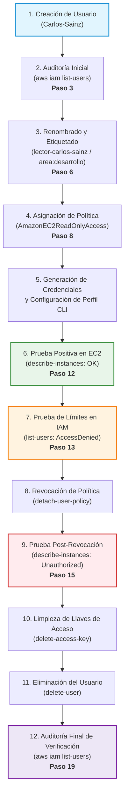
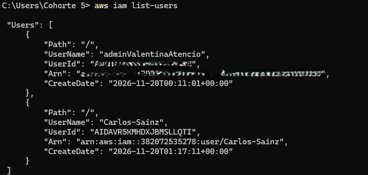
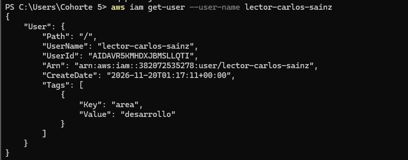
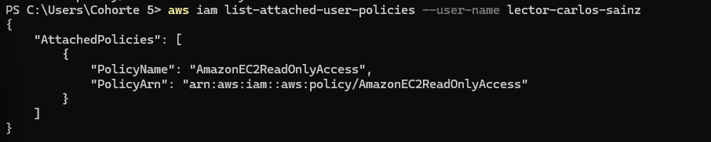
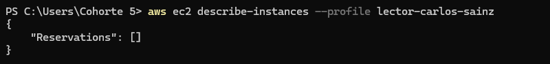
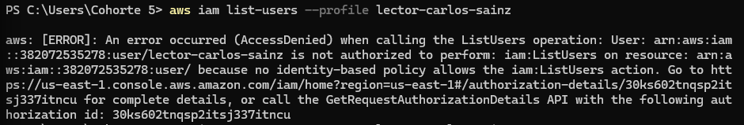
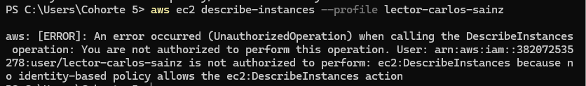
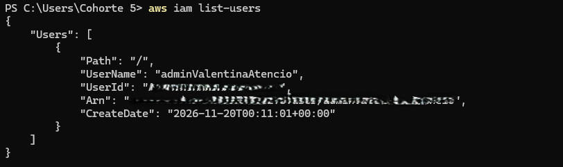

# Complementos AWS: Ciclo de Vida de un Usuario IAM

Este repositorio contiene la documentación técnica, evidencias fotográficas de ejecución en terminal y análisis conceptual de la actividad práctica sobre el **Ciclo de Vida de un Usuario en AWS IAM (Identity and Access Management)** utilizando la interfaz de línea de comandos de AWS (**AWS CLI**).

---

## 📋 Tabla de Contenido

- [Objetivos de la Actividad](#-objetivos-de-la-actividad)
- [Entorno de Trabajo y Datos del Laboratorio](#-entorno-de-trabajo-y-datos-del-laboratorio)
- [Diagrama del Ciclo de Vida IAM](#-diagrama-del-ciclo-de-vida-iam)
- [Estructura del Repositorio](#-estructura-del-repositorio)
- [Evidencias de Ejecución Paso a Paso](#-evidencias-de-ejecución-paso-a-paso)
  - [Paso 3: Verificación de creación del usuario](#paso-3-verificación-de-la-creación-del-usuario-iam)
  - [Paso 6: Renombrado del usuario e inspección de etiquetas](#paso-6-renombrado-del-usuario-e-inspección-de-etiquetas-tags)
  - [Paso 8: Asociación de política de solo lectura en EC2](#paso-8-asociación-de-política-de-solo-lectura-en-ec2)
  - [Paso 12: Validación de permisos asignados con perfil CLI](#paso-12-validación-de-permisos-asignados-con-perfil-cli-lectura-ec2)
  - [Paso 13: Prueba de límites de permisos (Principio de Menor Privilegio)](#paso-13-prueba-de-límites-de-permisos-principio-de-menor-privilegio)
  - [Paso 15: Comprobación post-revocación de política](#paso-15-comprobación-post-revocación-de-política)
  - [Paso 19: Eliminación definitiva y limpieza del usuario](#paso-19-eliminación-definitiva-y-limpieza-del-usuario)
- [Preguntas de Reflexión y Análisis Conceptual](#-preguntas-de-reflexión-y-análisis-conceptual)
- [Buenas Prácticas de Seguridad en IAM](#-buenas-prácticas-de-seguridad-en-iam)

---

## 🎯 Objetivos de la Actividad

1. **Gestionar identidades en la nube:** Crear, consultar, modificar y eliminar identidades de IAM programáticamente mediante AWS CLI.
2. **Aplicar políticas de seguridad:** Adjuntar y desvincular políticas administradas de AWS (`AmazonEC2ReadOnlyAccess`) para gobernar el acceso granular a recursos.
3. **Comprender el Principio de Menor Privilegio (*Principle of Least Privilege*):** Comprobar empíricamente cómo opera la denegación implícita por defecto (*Implicit Deny*) en AWS IAM.
4. **Auditar y diagnosticar errores:** Analizar las respuestas de la API de AWS y los códigos de error comunes como `AccessDenied` y `UnauthorizedOperation`.
5. **Gobernanza y buenas prácticas de ciclo de vida:** Ejecutar el ciclo completo de aprovisionamiento, asignación de etiquetas (*tags*), rotación/eliminación de credenciales (*access keys*) y desmantelamiento seguro de recursos huérfanos.

---

## 🖥️ Entorno de Trabajo y Datos del Laboratorio

| Parámetro | Detalle |
| :--- | :--- |
| **AWS Account ID** | `382072535278` |
| **Usuario Administrador** | `adminValentinaAtencio` (Perfil predeterminado) |
| **Usuario de Prueba (Inicial)** | `Carlos-Sainz` (`AIDAVR5KMHDXJBMSLLQTI`) |
| **Usuario de Prueba (Renombrado)**| `lector-carlos-sainz` (`AIDAVR5KMHDXJBMSLLQTI`) |
| **Etiquetas asignadas** | `area: desarrollo` |
| **Política AWS asignada** | `arn:aws:iam::aws:policy/AmazonEC2ReadOnlyAccess` |
| **Perfil AWS CLI secundario** | `lector-carlos-sainz` |
| **Shell / Entorno** | PowerShell 7 / Windows Terminal |

---

## 🔄 Diagrama del Ciclo de Vida IAM



---

## 📁 Estructura del Repositorio

```text
Complementos AWS/
│
├── evidencia/                                      # Capturas de pantalla de la ejecución
│   ├── paso_03.png                                 # Paso 3: Verificación de usuario inicial
│   ├── paso_06.png                                 # Paso 6: Verificación de renombrado y tags
│   ├── paso_08.png                                 # Paso 8: Verificación de política adjunta
│   ├── paso_12.png                                 # Paso 12: Consulta exitosa a EC2
│   ├── paso_13.png                                 # Paso 13: Error AccessDenied en IAM
│   ├── paso_15.png                                 # Paso 15: Error UnauthorizedOperation en EC2
│   └── paso_19.png                                 # Paso 19: Verificación de usuario eliminado
│
├── Actividad - ciclo de vida de un usuario IAM.md  # Documento base de la actividad
└── README.md                                       # Documentación principal del proyecto
```

---

## 📸 Evidencias de Ejecución Paso a Paso

A continuación se documentan las evidencias capturadas durante la sesión práctica, ubicadas en la carpeta [evidencia/](file:///c:/proyectos/Complementos%20AWS/evidencia):

### Paso 3: Verificación de la creación del usuario IAM

Se verifica la creación del usuario inicial `Carlos-Sainz` dentro de la cuenta mediante el perfil de administración.

- **Comando ejecutado:**
  ```bash
  aws iam list-users
  ```
- **Evidencia:**

  

- **Análisis de la salida:**
  - Se visualizan dos usuarios: el administrador `adminValentinaAtencio` y el usuario recién creado `Carlos-Sainz`.
  - El usuario `Carlos-Sainz` cuenta con un identificador único `UserId: AIDAVR5KMHDXJBMSLLQTI` y su respectivo ARN: `arn:aws:iam::382072535278:user/Carlos-Sainz`.
  - En este estado inicial, el usuario no tiene ninguna política de permisos adjunta (denegación implícita de todas las acciones).

---

### Paso 6: Renombrado del usuario e inspección de etiquetas (Tags)

Se comprueba la actualización del nombre de usuario a `lector-carlos-sainz` y la correcta asignación de etiquetas de categorización técnica.

- **Comando ejecutado:**
  ```bash
  aws iam get-user --user-name lector-carlos-sainz
  ```
- **Evidencia:**

  

- **Análisis de la salida:**
  - El nombre ha cambiado a `lector-carlos-sainz` y su ARN se ha actualizado correspondientemente a `arn:aws:iam::382072535278:user/lector-carlos-sainz`.
  - El identificador interno `UserId` permanece intacto (`AIDAVR5KMHDXJBMSLLQTI`), garantizando la continuidad de la entidad en AWS.
  - Se evidencia la etiqueta de gobierno de recursos:
    ```json
    "Tags": [
        {
            "Key": "area",
            "Value": "desarrollo"
        }
    ]
    ```

---

### Paso 8: Asociación de política de solo lectura en EC2

Se confirma la vinculación exitosa de la política administrada por AWS para lectura en instancias EC2.

- **Comando ejecutado:**
  ```bash
  aws iam list-attached-user-policies --user-name lector-carlos-sainz
  ```
- **Evidencia:**

  

- **Análisis de la salida:**
  - Se confirma adjunta la política `AmazonEC2ReadOnlyAccess` con ARN canónico `arn:aws:iam::aws:policy/AmazonEC2ReadOnlyAccess`.
  - Esta política concede únicamente permisos de consulta (acciones `ec2:Describe*`, `ec2:Get*`) sobre los recursos de Elastic Compute Cloud.

---

### Paso 12: Validación de permisos asignados con perfil CLI (Lectura EC2)

Se ejecutan consultas sobre los recursos de cómputo utilizando las credenciales programáticas asociadas al nuevo perfil local `lector-carlos-sainz`.

- **Comando ejecutado:**
  ```bash
  aws ec2 describe-instances --profile lector-carlos-sainz
  ```
- **Evidencia:**

  

- **Análisis de la salida:**
  - La llamada a la API retorna código de salida exitoso con una respuesta JSON `{ "Reservations": [] }`.
  - Al no haber instancias desplegadas en la región configurada, la lista de reservas está vacía, pero la llamada confirma que el usuario está debidamente **autenticado** y **autorizado** para describir instancias EC2.

---

### Paso 13: Prueba de límites de permisos (Principio de Menor Privilegio)

Se pone a prueba la frontera de privilegios del usuario intentando ejecutar una operación fuera del alcance de EC2 (administración de identidades en IAM).

- **Comando ejecutado:**
  ```bash
  aws iam list-users --profile lector-carlos-sainz
  ```
- **Evidencia:**

  

- **Análisis de la salida:**
  - La llamada falla con el error `AccessDenied`.
  - AWS provee un diagnóstico de autorización detallado:
    > `aws: [ERROR]: An error occurred (AccessDenied) when calling the ListUsers operation: User: arn:aws:iam::382072535278:user/lector-carlos-sainz is not authorized to perform: iam:ListUsers on resource: arn:aws:iam::382072535278:user/ because no identity-based policy allows the iam:ListUsers action.`
  - Este resultado confirma el cumplimiento del principio de mínimo privilegio: a falta de una política que permita explícitamente `iam:ListUsers`, la acción es denegada.

---

### Paso 15: Comprobación post-revocación de política

Tras desvincular la política `AmazonEC2ReadOnlyAccess`, se reitera la consulta sobre EC2 para comprobar la inmediatez de la revocación del permiso.

- **Comando ejecutado:**
  ```bash
  aws ec2 describe-instances --profile lector-carlos-sainz
  ```
- **Evidencia:**

  

- **Análisis de la salida:**
  - La operación es rechazada con el error `UnauthorizedOperation`:
    > `aws: [ERROR]: An error occurred (UnauthorizedOperation) when calling the DescribeInstances operation: You are not authorized to perform this operation. User: arn:aws:iam::382072535278:user/lector-carlos-sainz is not authorized to perform: ec2:DescribeInstances because no identity-based policy allows the ec2:DescribeInstances action`
  - Esto valida que la pérdida de la política surte efecto de forma inmediata y el usuario pierde toda capacidad de inspección de cómputo.

---

### Paso 19: Eliminación definitiva y limpieza del usuario

Se comprueba la fase final del ciclo de vida: desmantelamiento de credenciales y eliminación de la identidad IAM.

- **Comando ejecutado:**
  ```bash
  aws iam list-users
  ```
- **Evidencia:**

  

- **Análisis de la salida:**
  - El listado de usuarios de la cuenta refleja únicamente la cuenta administrativa `adminValentinaAtencio`.
  - El usuario `lector-carlos-sainz` ha sido purgado por completo de IAM, cerrando su ciclo de vida de manera segura y limpia.

---

## 💡 Preguntas de Reflexión y Análisis Conceptual

### 1. ¿Qué podía hacer el usuario justo después de crearlo, antes de adjuntarle una política? ¿Por qué?

> [!NOTE]
> **Respuesta:** No podía realizar ninguna acción operativa ni consultar recursos en los servicios de AWS (como listar usuarios en IAM o consultar instancias en EC2).

**Fundamento técnico:**  
En AWS IAM aplica por defecto el **modelo de denegación implícita (*Implicit Deny*)** y el **principio de menor privilegio (*Principle of Least Privilege*)**. Cuando una identidad (usuario o rol) es creada, posee una tabla de permisos totalmente vacía. A menos que exista una declaración explícita de permiso (`"Effect": "Allow"`) adjunta a través de una política basada en identidad o en recursos, la respuesta predeterminada del motor de evaluación de políticas de AWS es denegar la petición.

---

### 2. En el error del paso 13, ¿qué tres datos proporciona el mensaje?

> [!IMPORTANT]
> **Respuesta:** El mensaje de error `AccessDenied` desglosa con exactitud la tríada fundamental de control de acceso en AWS:

1. **Identidad solicitante (*Principal*):**  
   `User: arn:aws:iam::382072535278:user/lector-carlos-sainz`  
   Identifica inequívocamente a través de su ARN a la entidad autenticada que realizó la llamada.
2. **Acción denegada (*Action*):**  
   `iam:ListUsers`  
   Indica la operación de API específica que fue interceptada y bloqueada por falta de autorización.
3. **Recurso objetivo (*Resource*):**  
   `arn:aws:iam::382072535278:user/`  
   Especifica la ruta o recurso de destino sobre el cual se intentó ejecutar la acción.

Adicionalmente, el mensaje explica la causa raíz: *"because no identity-based policy allows the iam:ListUsers action"* e incluye un identificador único de solicitud de autorización (*authorization request id*) para fines de auditoría forense con AWS CloudTrail.

---

### 3. ¿Por qué cambió el ARN al renombrar el usuario?

> [!NOTE]
> **Respuesta:** Porque el nombre del usuario (`UserName`) forma parte estructural de la construcción del ARN (*Amazon Resource Name*).

**Comparativa del ARN:**
- **Antes del renombrado:** `arn:aws:iam::382072535278:user/Carlos-Sainz`
- **Después del renombrado:** `arn:aws:iam::382072535278:user/lector-carlos-sainz`

El ARN sigue la sintaxis general `arn:partition:service:region:account-id:resource-id`. Al modificarse el nombre lógico del recurso, el ARN debe reflejar esa nueva ruta.  
Sin embargo, **el identificador interno único (`UserId`) no cambia** (en este caso se mantuvo como `AIDAVR5KMHDXJBMSLLQTI`). Esto garantiza que los metadatos internos, fechas de creación y asignaciones no se pierdan durante la operación de renombrado.

---

### 4. ¿Por qué AWS obliga a borrar las llaves antes de borrar el usuario?

> [!WARNING]
> **Respuesta:** Para preservar la integridad referencial de seguridad, evitar credenciales huérfanas (*orphaned credentials*) y prevenir la eliminación involuntaria de cuentas con accesos programáticos activos.

**Razones clave:**
1. **Seguridad contra accesos inadvertidos:** Obligar al administrador a eliminar o inactivar las llaves de acceso (`Access Keys`) garantiza un acto deliberado de revocación de credenciales.
2. **Evitar identidades corruptas o zombies:** Si AWS permitiese eliminar el usuario manteniendo llaves activas, podría generarse inconsistencia en los logs de CloudTrail y en la autenticación firmada (SigV4).
3. **Integridad de dependencias:** Un usuario IAM es un contenedor de recursos secundarios (políticas inline, access keys, certificados de firma, dispositivos MFA). AWS exige limpiar los recursos dependientes para garantizar una eliminación controlada y segura.

---

### 5. ¿Qué pasaría si le hubieras dado `AdministratorAccess` en vez de solo lectura? ¿En qué caso real estaría justificado?

> [!CAUTION]
> **Riesgo:** Asignar `AdministratorAccess` (`"Action": "*", "Resource": "*"`) otorga control absoluto sobre el plano de control y de datos de la cuenta de AWS.

**Consecuencias de un acceso irrestricto:**
- Modificar o destruir infraestructura crítica de producción (bases de datos RDS, buckets S3, clústeres EKS).
- Crear nuevos usuarios con permisos elevados o alterar las políticas de auditoría y registros (CloudTrail).
- Exposición catastrófica si las llaves de acceso programáticas son filtradas o comprometidas por atacantes.
- Generación de sobrecostos financieros severos por aprovisionamiento malicioso o no autorizado de recursos.

**Casos reales en los que estaría justificado:**
- **Despliegue inicial de cuenta (*Bootstrap*):** Para el arquitecto de nube o administrador líder que configure las zonas de aterrizaje (*Landing Zones*), estructuras de organizaciones y roles iniciales.
- **Cuentas de emergencia (*Break-Glass / Break-Emergency*):** Cuentas destinadas a recuperación ante desastres cuando otros mecanismos de acceso han fallado.

*Incluso en dichos casos*, las mejores prácticas dictan que **no se deben utilizar Access Keys de larga duración** con `AdministratorAccess`; en su lugar, se debe requerir autenticación federada (SSO), MFA obligatorio y roles temporales asumidos a través de AWS STS (*Security Token Service*).

---

## 🛡️ Buenas Prácticas de Seguridad en IAM

```
           ┌──────────────────────────────────────────────┐
           │      Pilares de Seguridad en AWS IAM         │
           └──────────────────────┬───────────────────────┘
                                  │
       ┌──────────────────────────┼──────────────────────────┐
       ▼                          ▼                          ▼
┌──────────────┐          ┌──────────────┐          ┌────────────────┐
│   Least      │          │ Credenciales │          │  Auditoría y   │
│  Privilege   │          │  Temporales  │          │   Monitoreo    │
└──────┬───────┘          └──────┬───────┘          └───────┬────────┘
       │                         │                          │
  Políticas                 Uso de Roles               Logs activos
  mínimas por               STS en vez de             en CloudTrail
  necesidad                 Access Keys                e IAM Analyzer
```

1. **Principio de Menor Privilegio (PoLP):** Conceder exclusivamente las acciones requeridas sobre los recursos específicos necesarios.
2. **Preferencia por Roles y Credenciales Temporales:** Reducir o eliminar el uso de llaves de acceso estáticas para usuarios humanos; promover el uso de AWS IAM Identity Center (SSO).
3. **Habilitación de MFA (Multi-Factor Authentication):** Exigir un segundo factor de autenticación para todos los accesos a la consola y operaciones sensibles de API.
4. **Rotación y Auditoría Periódica:** Usar el Generador de Informes de Credenciales de IAM (*Credential Report*) para detectar llaves en desuso y eliminarlas oportunamente.
5. **Etiquetado Consistente (*Tagging*):** Clasificar usuarios y recursos por área, proyecto y entorno (`area: desarrollo`) para facilitar la gobernanza y políticas basadas en atributos (ABAC).
