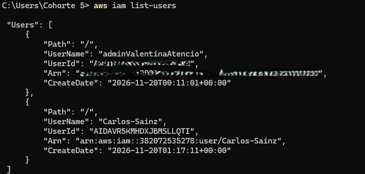
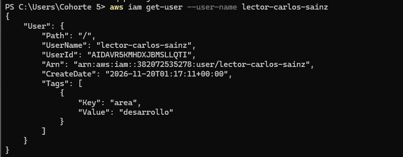
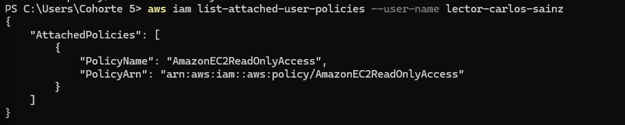
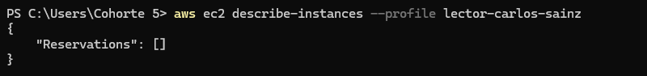
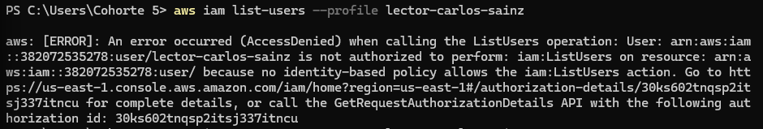
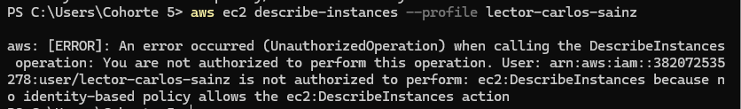
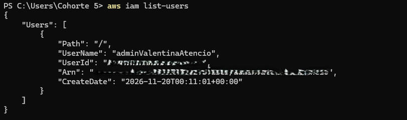

# Actividad: Ciclo de Vida de un Usuario IAM en AWS

**Materia / Módulo:** Complementos AWS  
**Entorno:** AWS CLI (v2)  
**Carpeta de Evidencias:** `evidencia/`

---

## 📸 Evidencias de Ejecución

### Paso 3: Verificación de la creación del usuario IAM inicial

Se verifica mediante el usuario administrador la existencia del nuevo usuario creado (`Carlos-Sainz`).

- **Comando:**
  ```bash
  aws iam list-users
  ```
- **Evidencia:**

  

- **Detalles observados:**
  - Se lista el usuario inicial `Carlos-Sainz` con ARN `arn:aws:iam::382072535278:user/Carlos-Sainz` e ID único `AIDAVR5KMHDXJBMSLLQTI`.
  - En esta fase de creación inicial, el usuario carece de políticas adjuntas.

---

### Paso 6: Renombrado del usuario y verificación de Tags

Se valida el cambio de nombre a `lector-carlos-sainz` y la adición de etiquetas de organización.

- **Comando:**
  ```bash
  aws iam get-user --user-name lector-carlos-sainz
  ```
- **Evidencia:**

  

- **Detalles observados:**
  - El ARN se ha modificado automáticamente para reflejar el nuevo nombre: `arn:aws:iam::382072535278:user/lector-carlos-sainz`.
  - El `UserId` (`AIDAVR5KMHDXJBMSLLQTI`) se preserva sin cambios.
  - Se confirma la etiqueta: `{"Key": "area", "Value": "desarrollo"}`.

---

### Paso 8: Comprobación de política adjunta

Se verifica la asociación de la política administrada de AWS `AmazonEC2ReadOnlyAccess`.

- **Comando:**
  ```bash
  aws iam list-attached-user-policies --user-name lector-carlos-sainz
  ```
- **Evidencia:**

  

- **Detalles observados:**
  - El usuario tiene vinculada la política `arn:aws:iam::aws:policy/AmazonEC2ReadOnlyAccess`.

---

### Paso 12: Consulta exitosa de instancias EC2 con perfil lector

Se ejecuta una consulta a EC2 utilizando el perfil configurado con las credenciales del usuario lector.

- **Comando:**
  ```bash
  aws ec2 describe-instances --profile lector-carlos-sainz
  ```
- **Evidencia:**

  

- **Detalles observados:**
  - La llamada se ejecuta satisfactoriamente retornando `{"Reservations": []}`, comprobando que la política de lectura sobre EC2 está operando correctamente.

---

### Paso 13: Prueba de límites de permisos (Error AccessDenied en IAM)

Se intenta listar usuarios de IAM utilizando el perfil del usuario lector para verificar las restricciones de privilegios.

- **Comando:**
  ```bash
  aws iam list-users --profile lector-carlos-sainz
  ```
- **Evidencia:**

  

- **Detalles observados:**
  - La solicitud es bloqueada con error `AccessDenied` debido a que el usuario únicamente tiene permisos para EC2 y no para el servicio IAM, validando el principio de menor privilegio.

---

### Paso 15: Comprobación post-revocación de política en EC2

Tras remover la política `AmazonEC2ReadOnlyAccess`, se intenta nuevamente describir instancias.

- **Comando:**
  ```bash
  aws ec2 describe-instances --profile lector-carlos-sainz
  ```
- **Evidencia:**

  

- **Detalles observados:**
  - La llamada falla con el error `UnauthorizedOperation`, lo que constata la revocación inmediata de los privilegios.

---

### Paso 19: Verificación de eliminación final del usuario

Se comprueba la remoción del usuario de la cuenta tras haber eliminado sus Access Keys y desvinculado sus recursos asociados.

- **Comando:**
  ```bash
  aws iam list-users
  ```
- **Evidencia:**

  

- **Detalles observados:**
  - El usuario `lector-carlos-sainz` ya no figura en el directorio de identidades IAM de la cuenta.

---

## ❓ Preguntas de Reflexión

### 1. ¿Qué podía hacer el usuario justo después de crearlo, antes de adjuntarle una política? ¿Por qué?

No podía realizar ninguna acción operativa sobre los servicios de AWS, como consultar instancias EC2 o listar usuarios IAM. Esto se debía a que, al crearlo, el usuario no tenía ningún permiso asignado.

AWS aplica de forma predeterminada el **principio de menor privilegio (*Least Privilege*)** y el modelo de **denegación implícita (*Implicit Deny*)**, por lo que un usuario nuevo carece de acceso hasta que se le asigne explícitamente una política con efecto `Allow`.

---

### 2. En el error del paso 13, ¿qué tres datos proporciona el mensaje?

El error `AccessDenied` del comando `aws iam list-users --profile lector-carlos-sainz` proporciona tres datos fundamentales para auditoría y resolución de problemas:

1. **Identidad (*Principal*):** Indica el usuario que realizó la solicitud mediante su ARN (`arn:aws:iam::382072535278:user/lector-carlos-sainz`).
2. **Acción denegada (*Action*):** Especifica la acción de la API que no fue autorizada (`iam:ListUsers`).
3. **Recurso (*Resource*):** Detalla sobre qué recurso o ruta se intentó ejecutar la operación (`arn:aws:iam::382072535278:user/`).

---

### 3. ¿Por qué cambió el ARN al renombrar el usuario?

El ARN (*Amazon Resource Name*) contiene el nombre del usuario IAM como parte de su estructura:

- **Antes:** `arn:aws:iam::382072535278:user/Carlos-Sainz`
- **Después:** `arn:aws:iam::382072535278:user/lector-carlos-sainz`

Al cambiar el nombre del usuario, AWS actualiza el ARN para reflejar el nuevo nombre de recurso. No obstante, el identificador único interno (`UserId: AIDAVR5KMHDXJBMSLLQTI`), las etiquetas y las políticas asociadas se conservan.

---

### 4. ¿Por qué AWS obliga a borrar las llaves antes de borrar el usuario?

Las llaves de acceso (*Access Keys*) son credenciales de autenticación criptográficas vinculadas al usuario para consumo mediante AWS CLI y SDKs.

AWS exige eliminar primero las llaves de acceso para:
- Evitar que queden credenciales huérfanas activas o inconsistencias en los sistemas de autenticación.
- Garantizar que el administrador esté consciente de revocar accesos programáticos antes de purgar la identidad.
- Mantener la higiene de seguridad y cumplir con estándares de auditoría.

---

### 5. ¿Qué pasaría si le hubieras dado `AdministratorAccess` en vez de solo lectura? ¿En qué caso real estaría justificado?

Si se hubiera asignado la política administrada `AdministratorAccess`, el usuario habría obtenido permisos globales y completos (`Action: *`, `Resource: *`) sobre toda la cuenta de AWS.

**Implicaciones de seguridad:**
- Capacidad para crear, modificar o eliminar cualquier recurso de la cuenta (instancias, bases de datos, redes, buckets S3).
- Posibilidad de crear o borrar usuarios y elevar privilegios a discreción.
- Riesgo severo de compromiso o pérdida total de infraestructura en caso de filtración de las credenciales de acceso.

**Casos justificados en escenarios reales:**
- Configuración inicial de la cuenta o arquitectura base (*account provisioning / bootstrap*).
- Cuentas de emergencia de tipo *Break-Glass* para contingencias críticas de soporte de infraestructura.
- Incluso en tales situaciones, la buena práctica exige utilizar autenticación multifactor (MFA), roles temporales asumidos (STS) y auditoría estricta en CloudTrail, evitando credenciales estáticas de larga duración.
