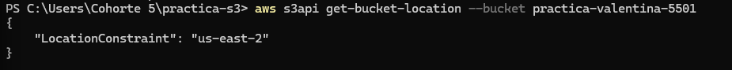
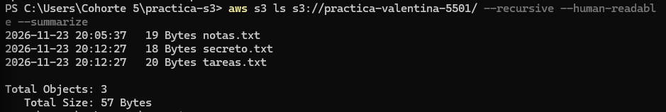
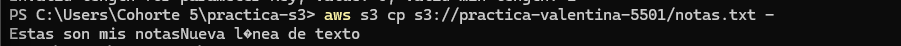
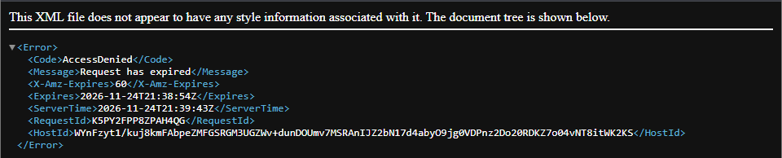
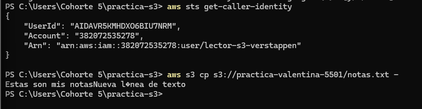
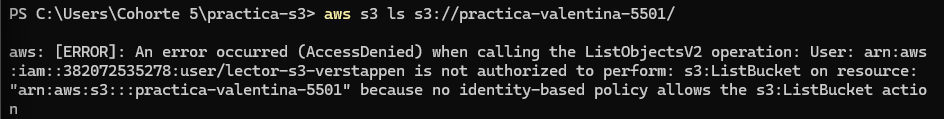
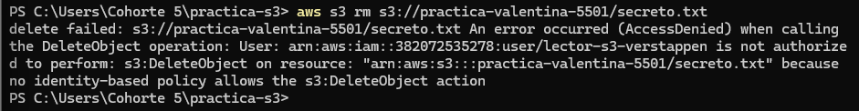
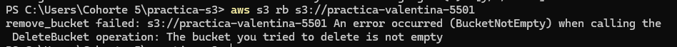
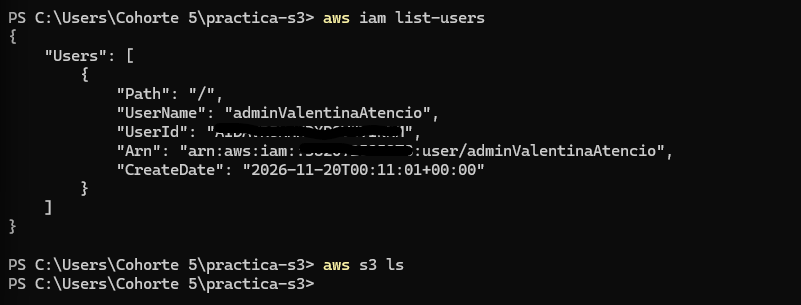

# Actividad: Ciclo de Vida de un Bucket en Amazon S3

**Materia / Módulo:** Complementos AWS  
**Entorno:** AWS CLI (v2) / Amazon S3 e IAM  
**Carpeta de Evidencias:** `evidencias/`  
**Bucket de Práctica:** `practica-valentina-5501` (`us-east-2`)

---

## 📸 Evidencias de Ejecución

### Paso 3: Verificación de la región y creación del bucket S3

Se valida la ubicación geográfica del bucket `practica-valentina-5501` tras su creación inicial.

- **Comando:**
  ```bash
  aws s3api get-bucket-location --bucket practica-valentina-5501
  ```
- **Evidencia:**

  

- **Detalles observados:**
  - La respuesta retorna `"LocationConstraint": "us-east-2"`, confirmando que el bucket fue aprovisionado en la región **EE. UU. Este (Ohio)**.

---

### Paso 7: Listado recursivo y resumen de objetos cargados

Se consultan los objetos almacenados en el bucket utilizando formato legible y resumen de almacenamiento.

- **Comando:**
  ```bash
  aws s3 ls s3://practica-valentina-5501/ --recursive --human-readable --summarize
  ```
- **Evidencia:**

  

- **Detalles observados:**
  - Se listan tres archivos en la raíz del bucket: `notas.txt` (19 Bytes), `secreto.txt` (18 Bytes) y `tareas.txt` (20 Bytes).
  - El resumen confirma `Total Objects: 3` y `Total Size: 57 Bytes`.

---

### Paso 13: Lectura directa del contenido actualizado de un objeto

Se imprime directamente en la salida estándar (`-`) el contenido de `notas.txt` sin descargarlo como archivo local, validando su actualización.

- **Comando:**
  ```bash
  aws s3 cp s3://practica-valentina-5501/notas.txt -
  ```
- **Evidencia:**

  

- **Detalles observados:**
  - El comando muestra en consola el contenido actualizado del objeto (`notas.txt`), comprobando la sobrescritura y lectura directa mediante `aws s3 cp` hacia `stdout`.

---

### Paso 16: Expiración de enlace temporal (Pre-signed URL)

Se intenta acceder desde el navegador a una URL prefirmada después de haberse cumplido su tiempo de vigencia.

- **Acción realizada:** Apertura de la URL prefirmada de S3 en el navegador tras superar el límite de expiración configurado.
- **Evidencia:**

  

- **Detalles observados:**
  - S3 responde con un documento XML de error `<Code>AccessDenied</Code>` y `<Message>Request has expired</Message>`.
  - Se evidencia que la firma tenía una vigencia de 60 segundos (`<X-Amz-Expires>60</X-Amz-Expires>`) con expiración a las `2026-11-24T21:38:54Z`, y al consultarse posteriormente (`<ServerTime>2026-11-24T21:39:43Z</ServerTime>`), el acceso queda revocado automáticamente.

---

### Paso 21: Verificación de identidad y lectura permitida con usuario IAM restringido

Se comprueba la identidad activa en AWS CLI y se valida que el usuario restringido puede leer objetos del bucket.

- **Comandos:**
  ```bash
  aws sts get-caller-identity
  aws s3 cp s3://practica-valentina-5501/notas.txt -
  ```
- **Evidencia:**

  

- **Detalles observados:**
  - `get-caller-identity` confirma el uso del usuario IAM `lector-s3-verstappen` (`arn:aws:iam::382072535278:user/lector-s3-verstappen`, `UserId: AIDAVR5KMHDX06BIU7NRM`).
  - La lectura de `notas.txt` se ejecuta con éxito, validando que la política asociada concede el permiso `s3:GetObject` sobre los objetos del bucket.

---

### Paso 22: Prueba de límites de permisos (Error `AccessDenied` al listar)

Con el mismo usuario `lector-s3-verstappen`, se intenta listar el contenido del bucket para comprobar el alcance real de su política.

- **Comando:**
  ```bash
  aws s3 ls s3://practica-valentina-5501/
  ```
- **Evidencia:**

  

- **Detalles observados:**
  - La operación `ListObjectsV2` falla con `AccessDenied`.
  - El mensaje especifica que el usuario no está autorizado para ejecutar `s3:ListBucket` sobre el recurso `arn:aws:s3:::practica-valentina-5501` porque ninguna política basada en identidad lo permite.

---

### Paso 23: Prueba de límites de permisos (Error `AccessDenied` al eliminar objetos)

Se intenta eliminar un objeto del bucket usando las credenciales del usuario `lector-s3-verstappen`.

- **Comando:**
  ```bash
  aws s3 rm s3://practica-valentina-5501/secreto.txt
  ```
- **Evidencia:**

  

- **Detalles observados:**
  - La eliminación falla con `AccessDenied` al invocar `DeleteObject` sobre `arn:aws:s3:::practica-valentina-5501/secreto.txt`.
  - Se valida el principio de menor privilegio: el usuario únicamente dispone de permisos de lectura de objetos (`s3:GetObject`) y no puede modificar ni borrar datos (`s3:DeleteObject`).

---

### Paso 24: Intento de eliminación de un bucket no vacío

Se intenta borrar el bucket antes de vaciar los objetos almacenados en su interior.

- **Comando:**
  ```bash
  aws s3 rb s3://practica-valentina-5501
  ```
- **Evidencia:**

  

- **Detalles observados:**
  - La operación `DeleteBucket` es rechazada con el error `BucketNotEmpty` (*The bucket you tried to delete is not empty*).
  - Esto demuestra que Amazon S3 impide eliminar un bucket que aún contiene objetos para evitar pérdidas accidentales de información; es obligatorio vaciarlo previamente (o utilizar `--force`).

---

### Paso 29: Verificación de limpieza final de recursos (IAM y S3)

Tras vaciar y eliminar el bucket y purgar el usuario de pruebas, se verifica el estado final de la cuenta.

- **Comandos:**
  ```bash
  aws iam list-users
  aws s3 ls
  ```
- **Evidencia:**

  

- **Detalles observados:**
  - `aws iam list-users` únicamente retorna al usuario administrador (`adminValentinaAtencio`), confirmando la eliminación de `lector-s3-verstappen`.
  - `aws s3 ls` no devuelve resultados, confirmando que el bucket `practica-valentina-5501` fue eliminado por completo y no quedan recursos residuales en la cuenta.

---

## ❓ Preguntas de Reflexión

### 1. ¿Por qué el nombre de tu bucket tuvo que ser distinto al de tus compañeros si cada uno tiene su propia cuenta?

Los nombres de los buckets en Amazon S3 pertenecen a un **espacio de nombres global único** compartido entre todas las cuentas y regiones de AWS, no aislado por cuenta. Esto se debe a que los buckets se exponen mediante URLs DNS globales (por ejemplo, `https://<nombre-bucket>.s3.<region>.amazonaws.com`). Por esa razón, dos cuentas distintas no pueden crear un bucket con el mismo nombre y fue necesario usar un identificador único como `practica-valentina-5501`.

---

### 2. El usuario del paso 21 pudo leer un archivo, pero en el paso 22 no pudo ver la lista. ¿Qué acción le faltaba en la política?

Le faltaba la acción **`s3:ListBucket`** aplicada sobre el ARN del bucket (`arn:aws:s3:::practica-valentina-5501`).

- En el **Paso 21**, `aws s3 cp s3://practica-valentina-5501/notas.txt -` funcionó porque invoca `s3:GetObject` directamente sobre un objeto cuya ruta ya era conocida.
- En el **Paso 22**, `aws s3 ls s3://practica-valentina-5501/` invoca la operación `ListObjectsV2`, la cual requiere explícitamente el permiso `s3:ListBucket` para consultar los metadatos y listar las claves contenidas en el bucket.

---

### 3. En la política, ¿qué significa el `/*` al final del `Resource`? ¿Qué pasaría si se quitara?

En Amazon S3, el sufijo `/*` distingue entre el **bucket** como contenedor y los **objetos** almacenados dentro de él:

- `arn:aws:s3:::practica-valentina-5501/*` apunta a **todos los objetos** dentro del bucket. Es el formato requerido para acciones a nivel de objeto como `s3:GetObject`, `s3:PutObject` o `s3:DeleteObject`.
- `arn:aws:s3:::practica-valentina-5501` (sin `/*`) apunta únicamente al **recurso del bucket**, necesario para acciones a nivel de bucket como `s3:ListBucket`.

**¿Qué pasaría si se quitara el `/*`?**  
El permiso `s3:GetObject` dejaría de coincidir con los ARN de los objetos (por ejemplo, `.../notas.txt`), por lo que cualquier intento de leer o descargar archivos con el usuario `lector-s3-verstappen` fallaría con `AccessDenied`.

---

### 4. ¿En qué se diferencia compartir un archivo con un enlace temporal de hacer público el bucket?

| Criterio | Enlace temporal (*Pre-signed URL*) | Bucket público |
| :--- | :--- | :--- |
| **Alcance** | Concede acceso únicamente a un **objeto específico** y a una operación concreta (ej. lectura). | Expone todo el bucket o los prefijos autorizados en la política pública. |
| **Duración** | Tiene una **caducidad definida** (en la práctica, 60 segundos; tras expirar devuelve `AccessDenied: Request has expired`). | Permanece accesible de forma indefinida hasta que se modifique la configuración o política. |
| **Seguridad** | El bucket sigue siendo **privado** (con *Block Public Access* activo) y el acceso se autentica mediante firma criptográfica temporal de un principal autorizado. | Cualquier persona en Internet puede acceder sin credenciales, lo que incrementa drásticamente el riesgo de exposición o fuga de datos. |

---

### 5. Según el modelo de responsabilidad compartida, si alguien deja un bucket público con datos de clientes, ¿de quién es la responsabilidad?

La responsabilidad es del **cliente** que administra la cuenta de AWS.

Según el **Modelo de Responsabilidad Compartida de AWS**:
- **AWS** es responsable de la seguridad **de** la nube (*Security of the Cloud*): la infraestructura física, los centros de datos, el hardware, las redes subyacentes y la disponibilidad del servicio Amazon S3.
- **El cliente** es responsable de la seguridad **en** la nube (*Security in the Cloud*): la clasificación de sus datos, el cifrado, las políticas IAM, las políticas de bucket y la configuración de *Block Public Access*.

Por lo tanto, una brecha originada por dejar un bucket público mal configurado recae directamente en el cliente.
