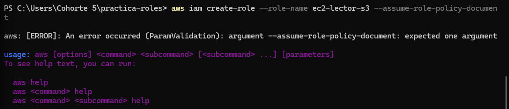
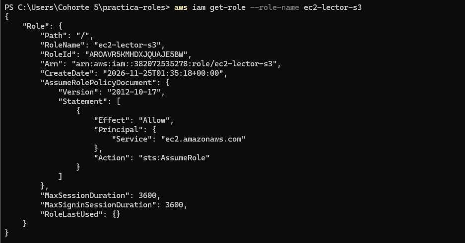
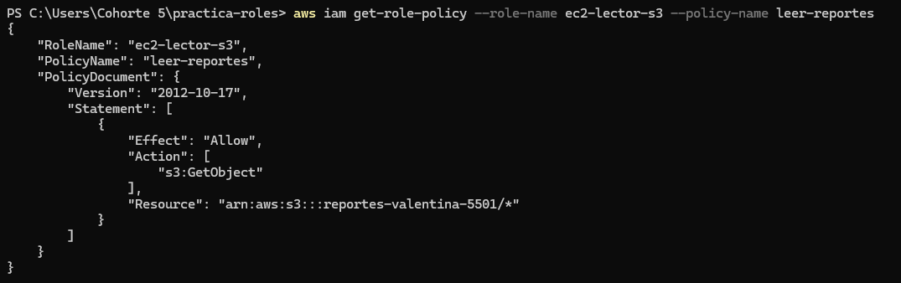
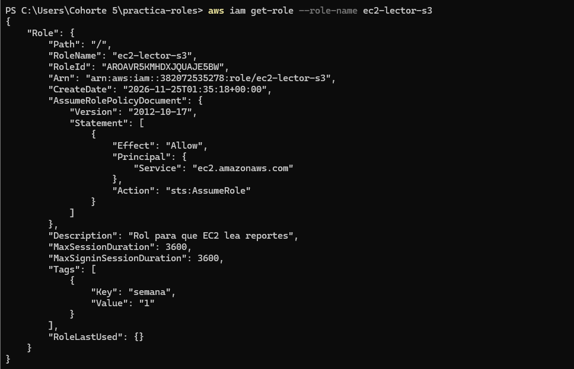
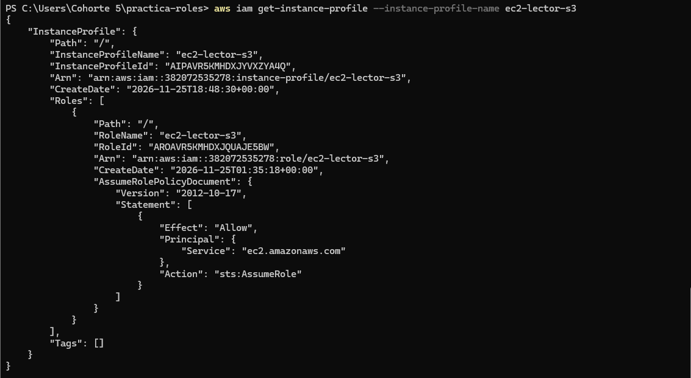
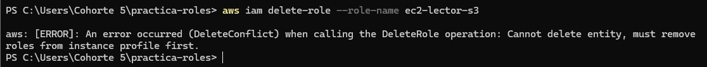

# Actividad: Ciclo de Vida de un Rol IAM para una Instancia EC2

**Materia / Módulo:** Complementos AWS  
**Entorno:** AWS CLI (v2) / AWS IAM y Amazon S3  
**Carpeta de Evidencias:** `evidencias/`  
**Rol de Práctica:** `ec2-lector-s3` (con acceso al bucket `reportes-valentina-5501`)

---

## 📸 Evidencias de Ejecución

### Paso 7: Validación de parámetro obligatorio al crear el rol (`ParamValidation`)

Se ejecuta el comando de creación del rol `ec2-lector-s3` omitiendo el valor del parámetro `--assume-role-policy-document` para observar el requisito de la política de confianza.

- **Comando:**
  ```bash
  aws iam create-role --role-name ec2-lector-s3 --assume-role-policy-document
  ```
- **Evidencia:**

  

- **Detalles observados:**
  - La CLI devuelve el error `ParamValidation` (`argument --assume-role-policy-document: expected one argument`).
  - Se comprueba que IAM exige definir una política de confianza desde el momento de crear el rol para establecer qué entidad tiene permitido asumirlo.

---

### Paso 9: Verificación del rol creado y su política de confianza

Una vez creado el rol con su documento de confianza, se consultan sus metadatos y la estructura de `AssumeRolePolicyDocument`.

- **Comando:**
  ```bash
  aws iam get-role --role-name ec2-lector-s3
  ```
- **Evidencia:**

  

- **Detalles observados:**
  - Se confirma la creación del rol `ec2-lector-s3` con `RoleId: AROAVR5KMHDXJQUAJE5BW` y ARN `arn:aws:iam::382072535278:role/ec2-lector-s3`.
  - La política de confianza autoriza al servicio `ec2.amazonaws.com` (`Principal.Service`) a ejecutar la acción `sts:AssumeRole` (`Effect: Allow`).
  - La duración máxima de sesión configurada por defecto es de `3600` segundos (1 hora).

---

### Paso 13: Comprobación de la política de permisos en línea (`leer-reportes`)

Se inspecciona la política en línea adjunta al rol para validar los permisos concedidos sobre Amazon S3.

- **Comando:**
  ```bash
  aws iam get-role-policy --role-name ec2-lector-s3 --policy-name leer-reportes
  ```
- **Evidencia:**

  

- **Detalles observados:**
  - La política en línea `leer-reportes` asociada a `ec2-lector-s3` otorga únicamente la acción `s3:GetObject`.
  - El recurso autorizado es `arn:aws:s3:::reportes-valentina-5501/*`, aplicando el principio de menor privilegio para leer exclusivamente objetos dentro del bucket indicado.

---

### Paso 16: Verificación de descripción y etiquetas agregadas al rol

Tras actualizar los metadatos organizativos del rol, se vuelve a consultar su configuración completa.

- **Comando:**
  ```bash
  aws iam get-role --role-name ec2-lector-s3
  ```
- **Evidencia:**

  

- **Detalles observados:**
  - Se confirma el campo `"Description": "Rol para que EC2 lea reportes"`.
  - Se verifica la etiqueta añadida en `"Tags"`: `{"Key": "semana", "Value": "1"}`.
  - El `RoleId`, el `Arn` y la política de confianza se mantienen intactos.

---

### Paso 19: Verificación del perfil de instancia (*Instance Profile*)

Se consulta el perfil de instancia `ec2-lector-s3` para confirmar que actúa como contenedor del rol hacia las instancias EC2.

- **Comando:**
  ```bash
  aws iam get-instance-profile --instance-profile-name ec2-lector-s3
  ```
- **Evidencia:**

  

- **Detalles observados:**
  - El perfil de instancia `ec2-lector-s3` (`InstanceProfileId: AIPAVR5KMHDXJYVXZYA4Q`, ARN `arn:aws:iam::382072535278:instance-profile/ec2-lector-s3`) existe correctamente.
  - En el arreglo `"Roles"` figura vinculado el rol `ec2-lector-s3`, habilitando su asignación a una instancia EC2.

---

### Paso 20: Intento de eliminación del rol sin desvincular dependencias (`DeleteConflict`)

Se intenta eliminar directamente el rol mientras aún se encuentra asociado al perfil de instancia y conserva su política en línea.

- **Comando:**
  ```bash
  aws iam delete-role --role-name ec2-lector-s3
  ```
- **Evidencia:**

  

- **Detalles observados:**
  - La operación `DeleteRole` falla con el error `DeleteConflict`: *Cannot delete entity, must remove roles from instance profile first*.
  - Esto demuestra que AWS impide borrar un rol con relaciones activas para proteger a las instancias o servicios que dependen de él.

---

## ❓ Preguntas de Reflexión

### 1. ¿Qué diferencia hay entre la política de confianza y la política de permisos? ¿Qué pasaría si el rol tuviera solo una de las dos?

La política de confianza define quién puede asumir el rol, en este caso, el servicio EC2. La política de permisos establece qué acciones puede realizar una vez que asume el rol. Si tuviera únicamente la política de confianza, EC2 podría asumirlo, pero no tendría permisos para acceder a los recursos. Si tuviera solo la política de permisos, no existiría una entidad autorizada para asumirlo.

---

### 2. ¿Por qué es más seguro que la instancia use un rol en vez de guardar una llave de acceso con `aws configure`?

Porque el rol proporciona credenciales temporales que AWS administra y renueva automáticamente. Esto evita guardar claves de acceso y claves secretas dentro de la instancia, reduciendo el riesgo de que sean robadas, expuestas o utilizadas por personas no autorizadas.

---

### 3. Con la política `leer-reportes`, ¿la instancia podrá listar el contenido del bucket? ¿Y borrar `reporte.txt`? Explica por qué.

No podrá realizar ninguna de las dos acciones. La política únicamente permite `s3:GetObject`, que sirve para leer objetos específicos. Para listar el contenido necesitaría `s3:ListBucket` y para borrar archivos necesitaría `s3:DeleteObject`. Como esos permisos no están incluidos, AWS denegará esas operaciones.

---

### 4. En el error del paso 20, ¿qué le falta por hacer antes de poder borrar el rol?

El error `DeleteConflict` del **Paso 20** indica que el rol aún tiene recursos dependientes vinculados. Para poder ejecutar `aws iam delete-role --role-name ec2-lector-s3` sin conflictos, se deben completar previamente los siguientes pasos de limpieza en orden:

1. **Desvincular el rol del perfil de instancia:**
   ```bash
   aws iam remove-role-from-instance-profile --instance-profile-name ec2-lector-s3 --role-name ec2-lector-s3
   ```
2. **Eliminar el perfil de instancia:**
   ```bash
   aws iam delete-instance-profile --instance-profile-name ec2-lector-s3
   ```
3. **Eliminar la política en línea asociada al rol (`leer-reportes`):**
   ```bash
   aws iam delete-role-policy --role-name ec2-lector-s3 --policy-name leer-reportes
   ```
4. **Eliminar el rol IAM:**
   ```bash
   aws iam delete-role --role-name ec2-lector-s3
   ```

---

### 5. Si mañana la instancia también necesita subir archivos al bucket, ¿qué cambiarías y en cuál de los dos archivos?

Se debe modificar únicamente el archivo de **política de permisos** (por ejemplo, `permisos.json`), agregando la acción **`s3:PutObject`** junto a `s3:GetObject` sobre el recurso `arn:aws:s3:::reportes-valentina-5501/*`, y volver a aplicarlo al rol con `aws iam put-role-policy`:

```json
{
  "Version": "2012-10-17",
  "Statement": [
    {
      "Effect": "Allow",
      "Action": [
        "s3:GetObject",
        "s3:PutObject"
      ],
      "Resource": "arn:aws:s3:::reportes-valentina-5501/*"
    }
  ]
}
```

El archivo de la **política de confianza** (`confianza.json`) **no se modifica**, porque la entidad que asume el rol sigue siendo el servicio `ec2.amazonaws.com` y lo único que cambia son las capacidades permitidas una vez asumido el rol.
